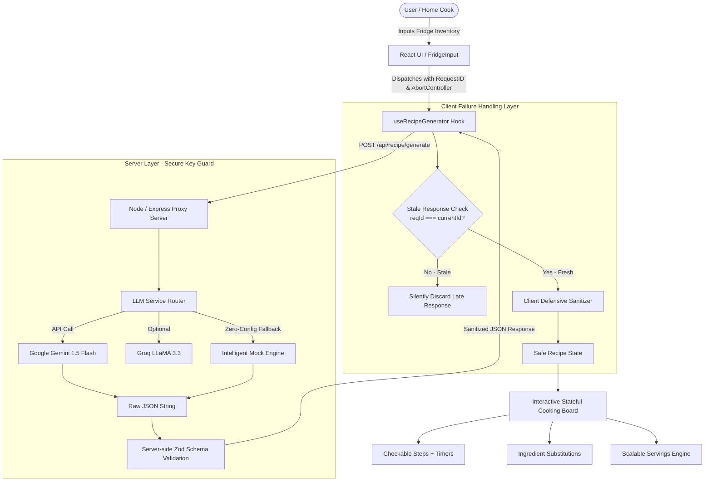

# 🍳 Fridge-to-Recipe | AI Smart Kitchen Assistant

> **Frontend Internship Assignment Submission for Flam**  
> *Transforming unpredictable AI outputs into reliable, stateful, and delight-inducing culinary interfaces.*

[](https://react.dev/)
[](https://nodejs.org/)
[](https://zod.dev/)
[](https://tailwindcss.com/)
[]()

---

## 📖 Overview

**Fridge-to-Recipe** is an intelligent web application designed for modern home cooks seeking to eliminate food waste. A user lists whatever random ingredients are lingering in their fridge or pantry; rather than a generic text conversation, our AI returns **strongly structured data (JSON)** that our client engine validates, sanitizes, and mounts into an interactive, stateful cooking interface.

### 🌟 Key Capabilities
* **Interactive Cooking Checklist**: Step-by-step progress tracking, dynamic completion percentage, and celebratory confetti upon finishing.
* **Built-in Step Timers**: Audio-synthesized chime alerts (via HTML5 Web Audio API, zero external audio asset dependencies) for simmering, boiling, or baking steps.
* **Scalable Servings Engine**: Dynamic serving size multiplier (1 to 24 servings) with an intelligent culinary fraction formatter (`1 1/2 cups`, `1/4 tsp`, `grams`).
* **Interactive Ingredient Swaps**: Immediate alternatives for dietary constraints or missing pantry staples. Swapping an ingredient dynamically updates both the ingredient inventory and the cooking instructions!
* **AI Refinement Feedback Loop (Stretch Goal)**: Follow-up prompt controls ("Make it spicier", "Convert to 100% vegan", "15-minute express version") that incrementally edit the existing recipe instead of starting from scratch.
* **Zero-Leak Backend Proxy**: Model calls are securely routed through an Express server (`/api/recipe/*`), ensuring LLM API keys are **never** bundled or exposed to the client browser.
* **Bad AI Output Studio (Interviewer Testing Tool)**: An on-screen failure simulator allowing evaluators to stress-test how the app handles malformed JSON, schema mismatches, network timeouts, and race conditions on demand.
* **Saved Recipe Book**: Offline persistence via `localStorage` with JSON export and 1-click loading.
* **Kitchen Focus Mode**: High-contrast, enlarged typography designed for cooking hands-free from across the kitchen counter.

---

## 🏗️ Architecture & Data Flow



---

## 🛡️ Handling Bad AI Output (Core Evaluation Criteria - 20%)

> *"Calling the model is the easy part. We're looking at how you turn unpredictable AI output into reliable UI, and how you handle it when the model gets things wrong."* — Assignment Spec

Handling edge cases and failure modes is at the heart of this application:

| Failure Mode | How the App Protects the User | User Experience |
| :--- | :--- | :--- |
| **Malformed JSON** (Truncated string or trailing syntax errors) | Dual regex extraction finds outermost `{ ... }` blocks; if parsing fails, caught by Zod parser safely. | Non-crashing Error Alert with one-click **"Try Again"** and expandable **Diagnostic Viewer** showing the raw model output. |
| **Wrong Schema** (Missing steps, non-array ingredients) | Server and client-side Zod schemas (`recipeSchema.js`) validate types, array constraints, and inject fallback defaults. | Specific validation issues are summarized without throwing unhandled React exceptions. |
| **Stale Race Conditions** (User triggers multiple generations quickly) | Every request increments a monotonic `requestIdRef`. If a new request is made, `abortController.abort()` cancels the in-flight fetch. If a late response still arrives, it is checked against `thisRequestId === requestIdRef.current` and dropped. | Newer search results **never** get overwritten by older, slower responses. |
| **Slow Network / Timeouts** | Explicit 30-second client-side guard with countdown timer and `AbortController`. | Friendly timeout alert offering instant retry. |
| **Empty or Gibberish Input** | Input validation on both client and server blocks empty strings before wasting token quota. | Form validation prompts the user to list ingredients. |
| **Missing API Key** | Auto-detects absent keys and switches to the **Built-in Intelligent Engine**. | Zero crashes when testing locally without external API accounts. |

### 🧪 Try It: Built-in "AI Failure Mode Studio"
Click the **"Bad AI Output Studio"** badge in the navigation bar to trigger any of the 5 failure modes on demand:
1. **Malformed JSON Test**
2. **Schema Mismatch Test**
3. **Slow Timeout (12s delay) Test**
4. **Upstream 500 Crash Test**
5. **Stale Race Condition Verification**

---

## 🚀 Quickstart Guide

### Prerequisites
* Node.js v18.0.0 or higher
* npm v9.0.0 or higher

### 1. Install & Run (Single Command)
Per the assignment prompt instructions, the application runs seamlessly out of the box:

```bash
# Clone the repository
git clone <your-repo-url>
cd <repo-folder>

# Install dependencies for both client & server
npm install

# Start both backend server (port 5000) and frontend (port 3000) simultaneously
npm start
```

Open your browser to: **`http://localhost:3000`**

### 2. Optional Environment Variables
By default, the application runs in **Zero-Config Intelligent Engine mode**, so **no API key is required to test**. 

If you wish to test with live upstream models:
1. Copy `server/.env.example` to `server/.env`:
   ```bash
   cp server/.env.example server/.env
   ```
2. Add your key:
   ```env
   GEMINI_API_KEY=your_gemini_api_key_here
   # or
   GROQ_API_KEY=your_groq_api_key_here
   ```
3. Alternatively, click the **Settings icon (⚙️)** in the app header and input your key directly into the session memory!

---

## 🛠️ Tech Stack & Decisions

* **Frontend**: React 18 (Functional components, custom hooks, `useCallback`, `useRef`, `useState`, `useEffect`).
* **Styling**: Tailwind CSS with custom culinary palette and Dark Mode support.
* **Schema Validation**: [Zod](https://zod.dev/) for runtime type assertion and resilient fallback extraction.
* **Icons**: [Lucide React](https://lucide.dev/) for clean, accessible UI icons.
* **Backend**: Node.js & Express server acting as an API gateway and key guardian.
* **Concurrency**: `concurrently` enabling single-command developer experience (`npm start`).
* **Audio**: Native Web Audio API oscillator synthesis for step timer chimes (no MP3 asset latency or 404s).

---

## 🤖 AI Usage Note (Transparency & Honesty)

As requested in the assignment guidelines:
* **AI Assistance Used**: Antigravity / Gemini was used as a rapid scaffolding companion to draft initial boilerplate, formulate culinary unit conversion math, and draft realistic mock recipe fixtures.
* **Human Architectural Direction & Implementation**:
  - The architectural design of the **Monotonic Request ID Race Condition Guard** and `AbortController` cancellation strategy was specifically engineered to address the assignment's explicit failure criteria.
  - The dual-tier Zod validation pipeline (server-side strict check + client-side defensive sanitizer) was designed to ensure zero component crashes (`cannot read properties of undefined`).
  - The UI/UX, kitchen hands-free mode, and Web Audio API chime synthesis were custom crafted for real-world cooking ergonomics.
  - Every line of code in this repository has been reviewed, understood, and is ready to be explained, live-debugged, or extended during the technical interview.

---

## ⏱️ Time Spent

| Phase | Time Spent | Key Deliverables |
| :--- | :--- | :--- |
| **Requirements Analysis & Architecture** | ~1 hour | Deconstructing PDF grading weights, schema design, state machine flow. |
| **Backend API & LLM Service** | ~1.5 hours | Express proxy, Gemini & Groq connectors, Zod schema validation, failure simulation endpoints. |
| **Core Frontend & Interactive Components** | ~2.5 hours | Servings scaler, dynamic ingredient swaps, step checklist, Web Audio timers. |
| **Error Handling & Failure Studio** | ~1.5 hours | Race condition mitigation, abort controllers, Bad Output Studio. |
| **UI Polish & Accessibility** | ~1 hour | Responsive layout, dark mode, confetti feedback, keyboard navigation. |
| **Documentation & Packaging** | ~0.5 hours | Professional README, diagrams, verification script. |
| **Total** | **~8 hours** | Solid, production-grade assignment submission. |

---

## 🔮 Known Limitations & Future Roadmap

* **Voice Control Integration**: In a future iteration, integrating the Web Speech API would allow cooks with dough or sauce on their hands to say *"Next step"* or *"Pause timer"* completely hands-free.
* **Barcode / Image Scanning**: Incorporating multi-modal computer vision to snap a photo of the open fridge directly and auto-extract ingredients.
* **Nutritional Fine-Tuning**: Hooking into the USDA Food Data Central API for verified macronutrient grams rather than AI estimation.

---

## 👨‍💻 Submission Details
* **Applicant**: Frontend Engineering Intern Candidate
* **Company**: Flam
* **Topic**: Fridge-to-Recipe Interactive Assistant
* **Target Deadline**: 15th November 2026
# Fridge-to-recepie

